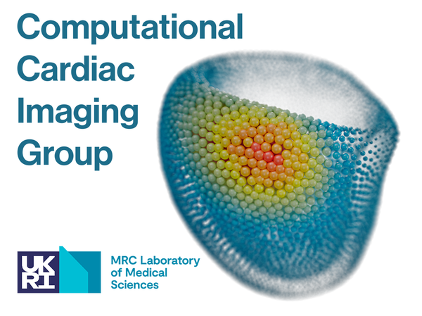

# OpenHeart — Cardiac MRI Analysis SDK

An installable SDK for short-axis cardiac MRI in hypertrophic cardiomyopathy (HCM):
nnU-Net segmentation → post-processing (slice realignment, apex completion) →
template mesh fitting with point correspondence → cardiac metrics (volumes, ejection
fraction, LV mass, myocardial wall thickness), for one case or a whole cohort.

<p align="center">
  <br>
  <sub>Example HCM case from a public dataset. Segmentation corrected by our QC agent; meshes and wall thickness by OpenHeart.</sub>
</p>

## Install

```bash
git clone https://github.com/ImperialCollegeLondon/OpenHeart && cd OpenHeart
pip install -e ".[seg,mesh]"     # segmentation + mesh fitting
```

The core (data model, pipeline runner, post-processing, volumes) needs only numpy,
scipy, nibabel and pandas. Heavy stacks are extras, imported only when their step runs:

| Extra | Adds | For |
|---|---|---|
| `seg` | torch, nnunetv2 | `Segment` |
| `mesh` | torch, scikit-image, vtk | `FitMesh`, 3D wall thickness, mesh files |
| `contour` | opencv | `Measure(contour_thickness=True)` |
| `luigi` | luigi | `scheduler="luigi"` |
| `gpu` | pytorch3d | faster mesh fitting ([build notes](docs/mesh.md#pytorch3d-recommended-for-fastsmooth-fitting)) |
| `plot`, `viz`, `hub`, `dev` | matplotlib, pyvista, huggingface_hub, pytest | examples, viewing, model download, tests |

## Quick start

```bash
openheart run cases/ -o out/ \
    --model /path/to/Dataset003_RBHSHare/nnUNetTrainer__nnUNetPlans__2d --folds 1 \
    --realign --jobs 4
```

`cases/` holds one folder per subject with `lvsa_ED.nii.gz` / `lvsa_ES.nii.gz`
(nested site or batch folders are fine). `out/` gets one folder per case plus
`metrics.csv`, one row per case. Run the same command again after an interruption
and it continues where it stopped.

## Python API

```python
import openheart as oh

pipe = oh.Pipeline([
    oh.Segment("/path/to/nnUNetTrainer__nnUNetPlans__2d", folds=[1]),
    oh.Realign(),
    oh.FillApex(),
    oh.FitMesh(),
    oh.Measure(),
])

# one case, all in memory
case = pipe(oh.Case.load("cases/000123_1", layout="legacy"))
case.segs["ED"]                  # Image: array + affine, labels 1=LV 2=myo 3=RV
case.meshes["ED"]["LVmyo"]       # Mesh with the template's topology
case.features["ED"]["LVmyo"]     # {"WallThickness": per-vertex mm}
case.metrics["lv_ef_pct"]

# a cohort, checkpointed and resumable
cohort = oh.Cohort.load("cases/", layout="legacy")
results = pipe.run(cohort, "out/", jobs=4)
df = results.to_dataframe()      # case_id, status, error, lv_edv_ml, lv_ef_pct, ...
results.failed                   # cases that raised, with their error
```

Every step takes a `Case` and returns it with more filled in, so steps can be
dropped, reordered or replaced; a custom step subclasses `oh.Step` and implements
`process(case)`.

| Step | Adds | Notes |
|---|---|---|
| `Segment(model, folds)` | `segs` | nnU-Net in process: model loaded once, no `nnUNet_*` variables or temp folders; output identical to `nnUNetv2_predict` |
| `Realign(degree=1)` | updates `images`, `segs` | shifts slices onto a fitted centreline (breath-hold misregistration) |
| `FillApex(max_slices=2)` | updates `images`, `segs` | closes an open LV apex with tapered myocardium caps |
| `FitMesh()` | `meshes` | fits the 4DSegment3.0 template; see [docs/mesh.md](docs/mesh.md) |
| `Measure(contour_thickness=False)` | `metrics`, `features` | volumes, SV, EF, LV mass; 3D wall thickness on the mesh; optional 2D thickness with AHA segments |

### Metrics

One flat row per case, lower snake case with the unit last: `lv_edv_ml`,
`lv_esv_ml`, `lv_sv_ml`, `lv_ef_pct`, `lv_mass_g`, `rv_edv_ml` … `rv_ef_pct`,
`myo_ed_ml`, `wt_{mean,median,max,p95}_{ed,es}_mm` (3D, from the mesh) and, with
`contour_thickness`, `wt2d_*` including `wt2d_aha01_ed_mm` … per AHA segment.
Demographics or other clinical tables join on `case_id` in pandas.

### Layouts

A layout says where a case's files are and how its labels are numbered; it reads
any dataset into the same `Case` and writes results back out.

| Layout | Files | Labels |
|---|---|---|
| `openheart` (default output) | `image_ED.nii.gz`, `seg_ED.nii.gz`, `meshes/LVmyo_ED.vtk`, `case.json` | 1 LV, 2 myo, 3 RV |
| `legacy` (default input) | `lvsa_ED.nii.gz` or `lvsa_SR_ED.nii.gz`, `seg_lvsa_SR_ED.nii.gz`, `vtks/F_LVmyo_ED.vtk`, `vtks/W_LVmyo_ED.vtk` | 1 LV, 2 myo, 3 RV |

Any layout takes `labels=` to override its convention (`"lv=3,myo=2,rv=1"`).

Any other dataset is read by describing its files; `{id}` is the case folder's name
and `{phase}` is `ED` or `ES` (`{phase_lower}` for `ed`, `es`):

```python
layout = oh.Layout(name="mine", image=("{id}_SA_{phase}.nii.gz",), seg="{id}_SA_{phase}_gt.nii.gz",
                   labels="lv=3,myo=2,rv=1", writable=False)
cohort = oh.Cohort.load("data/", layout=layout)
```

```bash
openheart run data/ -o out/ --image '{id}_SA_{phase}.nii.gz' --seg '{id}_SA_{phase}_gt.nii.gz'
```

If ED and ES are frame numbers that differ per case, add a text file to each case
folder with `ED: 1` and `ES: 12` lines, pass it as `frames` (`--frames`), and use
`{frame}` in the patterns, e.g. `{id}_frame{frame:02d}.nii.gz`.

### Resuming

With an output folder, each case is saved after every step and its `case.json`
records which steps (and which parameters) produced it. A re-run skips finished
cases, continues interrupted ones from their last completed step, and, when a
step's parameters change, recomputes from that step on, removing results of the
steps it replaces. One failing case is recorded in `metrics.csv` and does not stop
the run. `--scheduler luigi` runs the same work as [Luigi](https://github.com/spotify/luigi)
tasks (central scheduler and web UI with `luigi-central`); both schedulers read and
write the same checkpoints.

## Other tools

```bash
openheart fit --ed seg_ED.nii.gz --es seg_ES.nii.gz --out out/ --features   # mesh fitting only
openheart run cases/ -o qc_out/ --out-layout legacy ...                      # files the QC app reads
openheart export qc qc_out/ -o review.json                                   # QC app review list
openheart export nnunet reviewed/ -o $nnUNet_raw --dataset-id 3 --name RBHSHare
```

Training a model: [docs/training.md](docs/training.md). Plotting a metrics table:
`examples/plot_metrics.py`.

## Development

```bash
pip install -e ".[seg,mesh,contour,luigi,dev]"
git config core.hooksPath .githooks   # patient-data pre-commit check
pytest
```

| Module | Contents |
|---|---|
| `openheart/case.py` | `Case`, `Cohort` |
| `openheart/image.py`, `labels.py`, `layouts.py` | volumes and geometry, label conventions, on-disk layouts |
| `openheart/pipeline.py` | `Step`, `Pipeline`, local runner, checkpoint / resume |
| `openheart/segment.py`, `models.py` | nnU-Net segmentation, model lookup |
| `openheart/postprocess.py` | `realign`, `fill_apex` and their steps |
| `openheart/fit.py`, `openheart/mesh/` | `FitMesh` and the template mesh-fitting engine |
| `openheart/measure.py`, `contour_thickness.py` | volumes, function, wall thickness |
| `openheart/export.py`, `training.py` | QC app export, nnU-Net dataset export |
| `openheart/luigi_tasks.py`, `cli.py` | Luigi scheduler, command line |

## Credits

<a href="https://oreganlab.org"></a>

Developed by the [Computational Cardiac Imaging Group](https://oreganlab.org) at the
MRC Laboratory of Medical Sciences and Imperial College London. Mesh fitting is a
port of [4DSegment3.0](https://github.com/ImperialCollegeLondon/4DSegment3.0) (see
[docs/mesh.md](docs/mesh.md#credit--license)); 2D wall thickness is adapted from
Wenjia Bai's [ukbb_cardiac](https://github.com/baiwenjia/ukbb_cardiac) (Apache 2.0).
Segmentation uses [nnU-Net](https://github.com/MIC-DKFZ/nnUNet) — please cite it.
Released under the MIT License.
